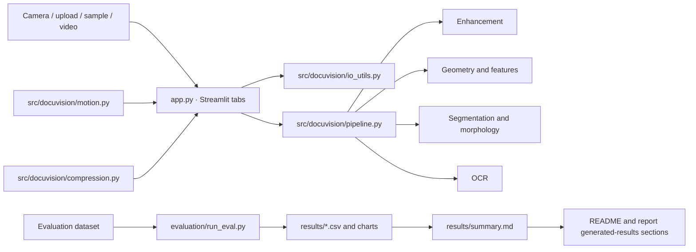

# DocuVision

DocuVision is a classical document-image processing teaching application. It
demonstrates image enhancement, segmentation, frequency filtering, morphology,
geometric registration, video tracking, compression, OCR, and reproducible
evaluation. The Streamlit interface is presentation and orchestration only;
processing implementations live in `src/docuvision/`.

## Screenshots

Replace these placeholders with screenshots captured from a running app:

<!-- Screenshot placeholder: capture the Scan tab with a processed sample. -->


<!-- Screenshot placeholder: capture the Unit 3 frequency and morphology lab. -->


<!-- Screenshot placeholder: capture the evaluation charts and tables. -->


## Architecture



## Syllabus map

| Syllabus unit | Topics | Main modules |
| --- | --- | --- |
| Unit 1 | Sampling, intensity transforms, histograms, spatial enhancement, pipeline | `enhancement.py`, `pipeline.py`, `io_utils.py`, `config.py` |
| Unit 2 | Thresholding, edges, connected components, region segmentation | `segmentation.py` |
| Unit 3 | Fourier spectrum and filters; mathematical morphology | `frequency.py`, `morphology.py` |
| Unit 4 | Geometric transforms, corners, feature matching and registration | `geometry.py`, `features.py` |
| Unit 5 | Frame differencing, optical flow, tracking and capture actions | `motion.py` |
| Unit 6 | Lossless coding, transform coding and rate-distortion | `compression.py` |
| Unit 7 | Synthetic degradation, image/OCR/geometry metrics and evaluation | `evaluation/` |
| Unit 9 | OCR with Tesseract and text error metrics | `ocr.py` |

## Lab experiment map

| Experiment | Project activity |
| --- | --- |
| Lab 12 | Compression lab: byte-level RLE/Huffman/LZW codecs, IGS, WHT/DCT |
| Lab 13 | Motion analysis and action detection: document tracker and stability capture |
| Lab 15 | Research article review: approved classical methods summarized in `docs/REPORT.md` |
| Other experiments | The brief does not assign experiment numbers to the remaining unit labs; use the syllabus map above. |

## Installation

Python 3.10 or newer is required. These steps create an isolated environment and
install the project plus its dependencies using only `requirements.txt`.

### Windows (PowerShell)

```powershell
py -3 -m venv .venv
.\.venv\Scripts\Activate.ps1
python -m pip install --upgrade pip
python -m pip install -r requirements.txt
```

### macOS

```bash
python3 -m venv .venv
source .venv/bin/activate
python -m pip install --upgrade pip
python -m pip install -r requirements.txt
```

### Linux

```bash
python3 -m venv .venv
source .venv/bin/activate
python -m pip install --upgrade pip
python -m pip install -r requirements.txt
```

Tesseract is an optional external OCR executable; image processing and tests
work without it. Install it to enable OCR:

| Platform | Installation |
| --- | --- |
| Windows | `winget install UB-Mannheim.TesseractOCR` |
| macOS | `brew install tesseract` |
| Debian/Ubuntu | `sudo apt-get update && sudo apt-get install -y tesseract-ocr` |

If the executable is not on `PATH`, set `TESSERACT_CMD` to its full path before
launching the app. For example, in PowerShell:

```powershell
$env:TESSERACT_CMD = "C:\Program Files\Tesseract-OCR\tesseract.exe"
```

Or in macOS/Linux:

```bash
export TESSERACT_CMD="$(command -v tesseract)"
```

## Run the application

From the repository root with the environment activated:

```bash
streamlit run app.py
```

The sidebar accepts an uploaded image, camera capture, or any image placed in
`data/samples/`. The Motion tab can generate a self-contained synthetic video
or accept a video upload. The app shows a warning when Tesseract is unavailable.

## Run tests and lint

```bash
pytest -q
ruff check .
```

Tests use deterministic synthetic images and do not download datasets or
models. Scratch implementations are intentionally suited to small images.

## Run evaluation

Generate deterministic clean, SET_A, and SET_B datasets, CSV metrics, charts,
and a Markdown summary:

```bash
python -m docuvision.evaluation.run_eval --n 30 --seed 2026
python scripts/sync_results_docs.py
```

`--n 2` is useful for a quick smoke run. Evaluation artifacts are written under
`results/`; the evaluation dataset is written under `data/evaluation/`.
PSNR/SSIM in SET_A use pixel-aligned clean/degraded pairs. OCR metrics are
omitted when Tesseract is unavailable. Compression measurements include actual
encoded stream headers in byte counts.

## Run the live camera/file demo

A graphical desktop session and a usable webcam are needed for camera mode:

```bash
python live_demo.py
```

Replay a file instead:

```bash
python live_demo.py --video path/to/video.mp4
```

Press **q** to quit and **s** to capture the current frame. Stable automatic
captures and manual captures are rectified and processed; files are saved under
`results/live/`. If a camera cannot be opened, the demo prints a camera setup
hint and exits without a traceback.

Convenience launchers for the Streamlit app are provided as `run.sh` and
`run.bat`.

## Results

The following section is synchronized from the generated
[`results/summary.md`](results/summary.md), which in turn is written from the
evaluation CSV files. Refresh it after a new evaluation with
`python scripts/sync_results_docs.py`; values are not maintained by hand.

<!-- BEGIN GENERATED EVALUATION SUMMARY -->

# Reproducible DocuVision Evaluation

- Pages per set: 2
- Dataset seed: 2026
- Tesseract available: False
- Image metrics compare each photometric SET_A output with its pixel-aligned clean page.
- Compression ratios use actual encoded byte streams, including codec headers.

## SET_A quality and OCR metrics (mean and standard deviation)

| method | metric | mean | std | n |
| --- | --- | --- | --- | --- |
| raw | psnr | 11.8149 | 0.0402 | 2 |
| raw | ssim | 0.8944 | 0.0014 | 2 |
| otsu_only | psnr | 15.4232 | 16.1489 | 2 |
| otsu_only | ssim | 0.7454 | 0.3209 | 2 |
| adaptive_only | psnr | 8.7371 | 0.1048 | 2 |
| adaptive_only | ssim | 0.1125 | 0.0261 | 2 |
| full_pipeline | psnr | 4.6683 | 0.2997 | 2 |
| full_pipeline | ssim | 0.6068 | 0.0159 | 2 |


## SET_B geometry and OCR

| metric | mean | std | n |
| --- | --- | --- | --- |
| corner_error_px | — | 0.0000 | 0 |
| sharpness | 103.5791 | 36.9117 | 2 |

## SET_A stage ablation

| omitted_stage | metric | mean | std | n |
| --- | --- | --- | --- | --- |
| illumination_correction | psnr | 11.6127 | 0.2227 | 2 |
| illumination_correction | ssim | 0.8691 | 0.0086 | 2 |
| denoise | psnr | 4.7388 | 0.2994 | 2 |
| denoise | ssim | 0.5505 | 0.0202 | 2 |
| contrast | psnr | 4.8098 | 0.3369 | 2 |
| contrast | ssim | 0.6589 | 0.0180 | 2 |
| sharpen | psnr | 4.6603 | 0.2964 | 2 |
| sharpen | ssim | 0.6212 | 0.0145 | 2 |
| binarize | psnr | 4.6683 | 0.2997 | 2 |
| binarize | ssim | 0.6068 | 0.0159 | 2 |
| morphology_cleanup | psnr | 4.6683 | 0.2997 | 2 |
| morphology_cleanup | ssim | 0.6068 | 0.0159 | 2 |

## Actual-byte codec comparison

| codec | ratio_mean | ratio_std | bytes_mean | lossless_fraction |
| --- | --- | --- | --- | --- |
| binary_jpeg_10 | 83.9558 | 0.0000 | 25906.0000 | 1.0000 |
| binary_jpeg_50 | 83.9526 | 0.0000 | 25907.0000 | 1.0000 |
| binary_jpeg_90 | 83.9526 | 0.0000 | 25907.0000 | 1.0000 |
| binary_png | 424.7139 | 0.0000 | 5121.0000 | 1.0000 |
| gray_jpeg_10 | 56.7417 | 3.9076 | 38422.0000 | 0.0000 |
| gray_jpeg_50 | 25.6869 | 2.2188 | 84989.0000 | 0.0000 |
| gray_jpeg_90 | 8.0236 | 0.4024 | 271413.0000 | 0.0000 |
| gray_png | 3.0061 | 0.0676 | 723710.0000 | 1.0000 |
| huffman_binary | 86998.4000 | 0.0000 | 25.0000 | 1.0000 |
| huffman_gray | 1.2504 | 0.0574 | 1741300.0000 | 1.0000 |
| lzw_binary | 691.7812 | 0.0000 | 3144.0000 | 1.0000 |
| lzw_gray | 2.1153 | 0.0686 | 1028763.5000 | 1.0000 |
| rle_binary | 127938.8235 | 0.0000 | 17.0000 | 1.0000 |
| rle_bitplanes | 1.0294 | 0.0335 | 2114054.0000 | 1.0000 |
| rle_gray | 1.1808 | 0.0191 | 1842215.0000 | 1.0000 |

## WHT vs DCT rate-distortion

| transform | parameter | CR_mean | PSNR_mean | PSNR_std | SSIM_mean |
| --- | --- | --- | --- | --- | --- |
| dct | keep=16 | 2.3143 | 32.4387 | 4.0369 | 0.8969 |
| dct | keep=64 | 1.4574 | 59.0349 | 0.0023 | 0.9992 |
| dct | qstep=24.0 | 3.2753 | 37.2601 | 0.7386 | 0.9605 |
| dct | qstep=8.0 | 2.6504 | 44.8948 | 0.3303 | 0.9883 |
| wht | keep=16 | 2.2741 | 30.1205 | 1.8822 | 0.8994 |
| wht | keep=64 | 1.4080 | 58.1975 | 0.0514 | 0.9991 |
| wht | qstep=24.0 | 3.1923 | 36.8219 | 0.8014 | 0.9530 |
| wht | qstep=8.0 | 2.5662 | 44.7919 | 0.2270 | 0.9884 |


Raw per-page data is available in the adjacent CSV files.
<!-- END GENERATED EVALUATION SUMMARY -->

## Limitations

- A white page on a white table may not produce a sufficiently strong page
  boundary for contour-based corner detection.
- Strong glare or clipped highlights destroy local contrast and cannot be
  recovered reliably by these classical methods.
- Document tracking depends on visible corners/features and can lose its
  homography when too few points survive.
- OCR requires a separately installed Tesseract executable and language data.
- SURF is not used: it is patented and absent from standard OpenCV builds.
  SIFT and ORB are provided instead.
- Evaluation runs are synthetic and should not be interpreted as a benchmark
  on all cameras, papers, languages, or real-world document layouts.

## Future work

- Improve page detection under low contrast, clutter, and glare.
- Add multi-page PDF export and OCR language selection in the interface.
- Evaluate on a larger, consented real capture set and report uncertainty.
- Add user-controlled tracking overlays and a GPU-free mobile capture workflow.
- Expand tests for codec corruption, camera hardware, and cross-platform packaging.
