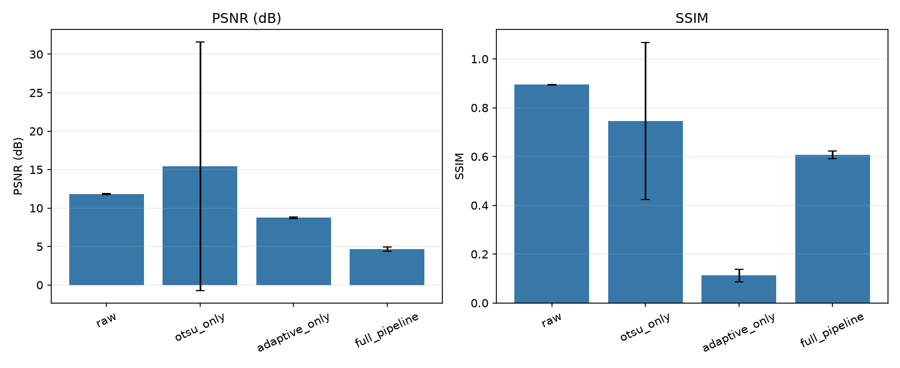
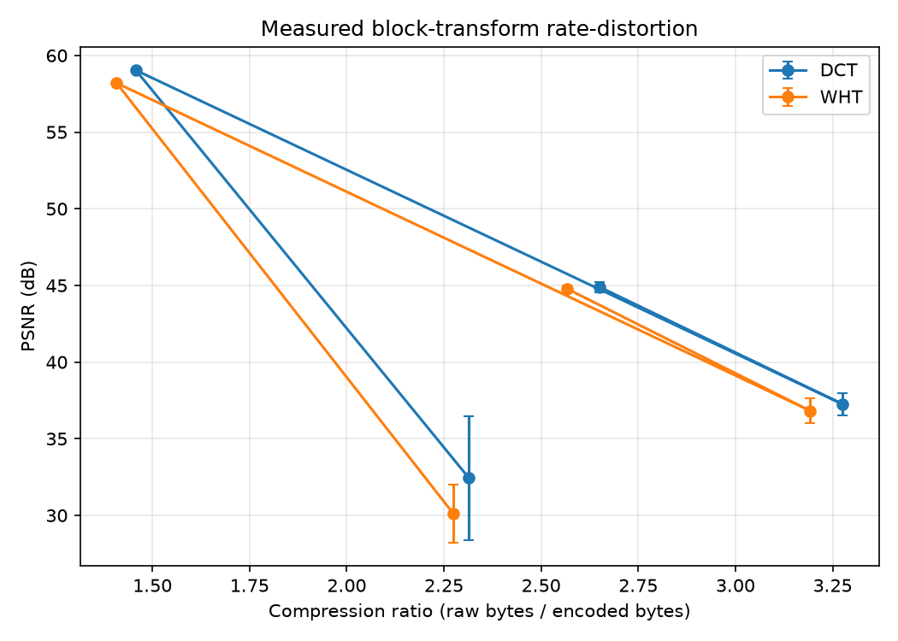

# DocuVision: Classical Document Image Processing

## Abstract

DocuVision is an educational document-scanning system that combines classical
image processing with a video capture workflow. Its Python modules implement
intensity enhancement, spatial filtering, thresholding, morphology, geometric
rectification, feature matching, optical flow, byte-level lossless coding,
transform coding, and OCR integration. A Streamlit application exposes these
methods through syllabus-oriented laboratory tabs. A deterministic synthetic
evaluation runner writes per-image measurements, aggregate CSVs, charts, and a
Markdown summary. OCR is optional and requires an installed Tesseract binary.

## Introduction

Document capture is affected by uneven illumination, blur, sensor noise,
perspective, page motion, and compression. DocuVision demonstrates a
reproducible processing sequence: acquire an image, estimate and rectify a
document when possible, enhance its grayscale representation, derive a binary
image, clean and segment the page, then optionally recognize text. Separate
modules let learners inspect individual algorithms rather than treating the
system as a black box.

The application uses NumPy arrays and established OpenCV/scikit-image
implementations. Scratch versions are provided for selected syllabus methods
on small arrays. No deep-learning model or pretrained model is used.

## Literature review — Research Article Review (Lab Exp 15)

Only the five approved research articles are reviewed below.

### Otsu (1979)

- **Problem:** Select a global image threshold without manually labeling the
  foreground and background classes.
- **Method:** Exhaustively evaluate candidate gray-level thresholds and choose
  the one maximizing between-class variance (equivalently minimizing
  within-class variance).
- **DocuVision use:** `segmentation.otsu_scratch` implements the criterion,
  while `segmentation.otsu_cv` wraps OpenCV. The Scan pipeline and Evaluation
  tab use Otsu as a global threshold baseline.

### Lucas and Kanade (1981)

- **Problem:** Estimate image motion locally from two nearby frames.
- **Method:** Assume brightness constancy and locally constant flow, then solve
  an overdetermined least-squares system for horizontal and vertical
  displacement.
- **DocuVision use:** `motion.lucas_kanade_scratch` constructs and solves the
  local system; `motion.lucas_kanade_cv` uses pyramidal OpenCV LK with
  forward-backward validation. `DocumentTracker` uses valid feature tracks to
  estimate page motion.

### Horn and Schunck (1981)

- **Problem:** Estimate dense image flow even where local motion constraints
  alone are underdetermined.
- **Method:** Minimize a brightness-constancy error together with a spatial
  smoothness penalty over the flow field.
- **DocuVision use:** `motion.horn_schunck_scratch` performs iterative dense
  flow estimation on downscaled frames. `flow_to_color` and `draw_flow_arrows`
  visualize the result.

### Lowe (2004)

- **Problem:** Identify local image features that remain useful under changes
  in scale, rotation, and moderate viewpoint.
- **Method:** Detect Difference-of-Gaussian extrema across position and scale,
  then describe and match local neighborhoods; reject ambiguous descriptor
  matches using the nearest-to-second-nearest distance ratio.
- **DocuVision use:** OpenCV SIFT supplies keypoints and descriptors;
  `features.match_features` applies the ratio test and
  `features.estimate_homography` uses RANSAC for registration.

### Sauvola and Pietikäinen (2000)

- **Problem:** Binarize document text under locally varying background
  illumination and contrast.
- **Method:** Compute a local threshold from neighborhood mean and standard
  deviation, allowing the threshold to adapt to local contrast.
- **DocuVision use:** `segmentation.sauvola` delegates to
  `skimage.filters.threshold_sauvola`; it is the default balanced pipeline
  binarizer and is compared with global and adaptive thresholds.

## Methodology

### Unit 1 — Image representation and enhancement

Images are represented as `uint8` grayscale or BGR arrays. For an image
intensity \(f(x,y)\), the digital negative is \(s=255-f\). A power-law mapping
uses \(s=255(f/255)^\gamma\). Sampling by factor \(r\) selects every \(r\)-th
row and column; uniform quantization maps intensities to a finite level set.
Mean, Gaussian, and median filters demonstrate linear smoothing and nonlinear
impulse-noise suppression. Unsharp masking adds a scaled detail signal:

\[
g(x,y)=f(x,y)+k\left(f(x,y)-f_{\mathrm{blur}}(x,y)\right).
\]

The ordered pipeline retains stage images and timing metadata for inspection.

### Unit 2 — Segmentation and edge detection

For a binary image, connected-component labels are produced under either
4-neighbor or 8-neighbor connectivity. Gradient methods estimate \(G_x,G_y\);
the edge magnitude and orientation are

\[
M(x,y)=\sqrt{G_x^2+G_y^2},\qquad
\theta(x,y)=\operatorname{atan2}(G_y,G_x).
\]

Otsu selects a global threshold from class statistics; adaptive mean/Gaussian
and Sauvola methods use local neighborhoods. Region growing uses a seed,
intensity tolerance, and selected connectivity. Split-and-merge recursively
splits high-variance regions and merges adjacent regions with similar means.
Watershed uses distance-derived peak markers to separate touching foreground
objects.

### Unit 3 — Frequency processing and morphology

The 2D discrete Fourier transform is

\[
F(u,v)=\sum_x\sum_y f(x,y)e^{-2\pi i(ux/M+vy/N)}.
\]

The UI centers the frequency origin for display and filter masks. Ideal,
Butterworth, and Gaussian lowpass masks retain low spatial frequencies;
highpass masks are their complements. A Butterworth response changes more
gradually than an ideal cutoff, reducing the abrupt frequency truncation that
causes ringing. Frequency filtering pads images before transforming to reduce
opposite-edge wraparound, then crops to the source extent.

Morphology applies a structuring element to neighborhoods. Erosion contracts
bright foreground, dilation expands it, opening removes small bright details,
and closing fills small gaps. The morphological gradient is dilation minus
erosion; top-hat and black-hat isolate small bright and dark structures.
Walsh-Hadamard transforms use orthonormal row/column bases, so the inverse is
the transpose basis operation.

\[
\mathrm{gradient}(f)=\mathrm{dilate}(f)-\mathrm{erode}(f),\qquad
\mathrm{opening}(f)=\mathrm{dilate}(\mathrm{erode}(f)).
\]

### Unit 4 — Geometry and features

An affine mapping in homogeneous coordinates is

\[
\begin{bmatrix}x'\\y'\\1\end{bmatrix}
=
\begin{bmatrix}a&b&t_x\\c&d&t_y\\0&0&1\end{bmatrix}
\begin{bmatrix}x\\y\\1\end{bmatrix}.
\]

Perspective page rectification estimates a homography \(H\) from four
corresponding corners, with \(\mathbf{x}'\sim H\mathbf{x}\). Harris corners
evaluate the determinant and trace of the local gradient covariance matrix;
SIFT and ORB provide local descriptors, and RANSAC estimates a robust
homography from accepted matches. Gaussian and Laplacian pyramids demonstrate
multi-scale image representation. DoG levels approximate scale-normalized
LoG responses.

### Unit 5 — Motion and action detection

Brightness constancy gives \(I_xu+I_yv+I_t=0\). Lucas-Kanade solves the local
least-squares system; corners track better than straight edges because their
local gradient matrix constrains motion in two directions rather than one.
Pyramidal LK handles larger displacements by solving at coarse resolution and
refining at finer levels. Horn-Schunck adds a smoothness term to the data
constraint.

\[
E(u,v)=\iint\left[(I_xu+I_yv+I_t)^2+
\alpha^2\left(\lvert\nabla u\rvert^2+\lvert\nabla v\rvert^2\right)\right]dx\,dy.
\]

The document tracker estimates motion from Shi-Tomasi points inside a page
polygon, updates its corners with a RANSAC homography, and periodically
re-detects the page. A finite-state detector identifies movement, a stable
pause, capture of the sharpest stable frame, and a subsequent page change.

### Unit 6 — Compression

Run-length coding stores consecutive identical symbols; Huffman coding builds
a prefix code from symbol frequencies; LZW grows a dictionary of byte
sequences. Huffman coding aims to minimize expected code length among
prefix-free codes for the measured symbol distribution. IGS adds accumulated
low-order information before quantization to reduce visible contouring.

For block transform coding, an 8×8 block is transformed, coefficients are
retained or uniformly quantized, and serialized signed coefficients are
Huffman-coded. The measured compression ratio includes headers:

\[
\mathrm{CR}=\frac{\text{uncompressed bytes}}{\text{encoded stream bytes}}.
\]

For peak value \(L=255\), PSNR is

\[
\mathrm{PSNR}=10\log_{10}\frac{L^2}{\mathrm{MSE}}.
\]

SSIM supplements pixel error with a local structural comparison.

### Unit 7 — Evaluation and reproducibility

Synthetic pages are generated with fixed seeds. SET_A applies photometric
degradations without geometric displacement, allowing aligned PSNR/SSIM
comparisons. SET_B adds perspective and rotation, with known corner positions
for geometry evaluation. The runner records per-page measurements and
aggregates means and standard deviations from CSV data. Ablation results are
computed by disabling one processing stage at a time. Evaluation output is
descriptive for the chosen synthetic sample, not a universal benchmark.
An empty corner-error sample is recorded as missing instead of treating it as
a zero-error result.

### Unit 9 — OCR

`ocr.run_ocr` requests text and word-level boxes/confidences from Tesseract.
OCR is an optional external executable; unavailable or failed OCR is represented
by an explicit status. Character and word error rates use normalized strings
and edit distance:

\[
\mathrm{CER}=\frac{d_{\mathrm{Lev}}(r,h)}{\lvert r\rvert},\qquad
\mathrm{WER}=\frac{d_{\mathrm{Lev}}(r_w,h_w)}{\lvert r_w\rvert}.
\]

## Implementation

| Component | Responsibility |
| --- | --- |
| `enhancement.py` | Intensity transforms, histogram operations, spatial filters, noise, arithmetic |
| `segmentation.py` | Components, classical edges, thresholds, region and graph segmentation, watershed |
| `frequency.py` | DFT/FFT, centered filters, homomorphic filtering, WHT and ringing examples |
| `morphology.py` | NumPy scratch and OpenCV morphology plus document-oriented operations |
| `geometry.py` | Affine transforms and document corner detection |
| `features.py` | Harris, Shi-Tomasi, Hessian blobs, SIFT/ORB, pyramids, matching, HOG |
| `motion.py` | Frame difference, LK/HS flow, document tracking, stability state machine, video analysis |
| `compression.py` | Real byte streams for RLE/Huffman/LZW and WHT/DCT transform coding |
| `pipeline.py` | Ordered, timed, toggleable stages; exports PDF from the final grayscale page |
| `ocr.py` | Tesseract integration and normalized CER/WER |
| `evaluation/` | Seeded degradations/dataset, image metrics, CSV/chart/report generation |
| `ui/` and `app.py` | Streamlit controls, stage displays, plots, and downloads |

Each library operation accepts arrays and parameters; UI modules call these
library functions instead of duplicating image algorithms. Tests use synthetic
images and do not require an internet connection.

## Results

All measurements below are reproduced from the generated
[`results/summary.md`](../results/summary.md), itself aggregated from
`results/*.csv`. Regenerate the dataset and measurements with the evaluation
command, then synchronize the README and report with
`python scripts/sync_results_docs.py`.

<!-- BEGIN GENERATED EVALUATION SUMMARY -->

# Reproducible DocuVision Evaluation

- Pages per set: 2
- Dataset seed: 2026
- Tesseract available: False
- Image metrics compare each photometric SET_A output with its pixel-aligned clean page.
- Compression ratios use actual encoded byte streams, including codec headers.

## SET_A quality and OCR metrics (mean and standard deviation)

| method | metric | mean | std | n |
| --- | --- | --- | --- | --- |
| raw | psnr | 11.8149 | 0.0402 | 2 |
| raw | ssim | 0.8944 | 0.0014 | 2 |
| otsu_only | psnr | 15.4232 | 16.1489 | 2 |
| otsu_only | ssim | 0.7454 | 0.3209 | 2 |
| adaptive_only | psnr | 8.7371 | 0.1048 | 2 |
| adaptive_only | ssim | 0.1125 | 0.0261 | 2 |
| full_pipeline | psnr | 4.6683 | 0.2997 | 2 |
| full_pipeline | ssim | 0.6068 | 0.0159 | 2 |

## SET_B geometry and OCR

| metric | mean | std | n |
| --- | --- | --- | --- |
| corner_error_px | — | 0.0000 | 0 |
| sharpness | 103.5791 | 36.9117 | 2 |

## SET_A stage ablation

| omitted_stage | metric | mean | std | n |
| --- | --- | --- | --- | --- |
| illumination_correction | psnr | 11.6127 | 0.2227 | 2 |
| illumination_correction | ssim | 0.8691 | 0.0086 | 2 |
| denoise | psnr | 4.7388 | 0.2994 | 2 |
| denoise | ssim | 0.5505 | 0.0202 | 2 |
| contrast | psnr | 4.8098 | 0.3369 | 2 |
| contrast | ssim | 0.6589 | 0.0180 | 2 |
| sharpen | psnr | 4.6603 | 0.2964 | 2 |
| sharpen | ssim | 0.6212 | 0.0145 | 2 |
| binarize | psnr | 4.6683 | 0.2997 | 2 |
| binarize | ssim | 0.6068 | 0.0159 | 2 |
| morphology_cleanup | psnr | 4.6683 | 0.2997 | 2 |
| morphology_cleanup | ssim | 0.6068 | 0.0159 | 2 |

## Actual-byte codec comparison

| codec | ratio_mean | ratio_std | bytes_mean | lossless_fraction |
| --- | --- | --- | --- | --- |
| binary_jpeg_10 | 83.9558 | 0.0000 | 25906.0000 | 1.0000 |
| binary_jpeg_50 | 83.9526 | 0.0000 | 25907.0000 | 1.0000 |
| binary_jpeg_90 | 83.9526 | 0.0000 | 25907.0000 | 1.0000 |
| binary_png | 424.7139 | 0.0000 | 5121.0000 | 1.0000 |
| gray_jpeg_10 | 56.7417 | 3.9076 | 38422.0000 | 0.0000 |
| gray_jpeg_50 | 25.6869 | 2.2188 | 84989.0000 | 0.0000 |
| gray_jpeg_90 | 8.0236 | 0.4024 | 271413.0000 | 0.0000 |
| gray_png | 3.0061 | 0.0676 | 723710.0000 | 1.0000 |
| huffman_binary | 86998.4000 | 0.0000 | 25.0000 | 1.0000 |
| huffman_gray | 1.2504 | 0.0574 | 1741300.0000 | 1.0000 |
| lzw_binary | 691.7812 | 0.0000 | 3144.0000 | 1.0000 |
| lzw_gray | 2.1153 | 0.0686 | 1028763.5000 | 1.0000 |
| rle_binary | 127938.8235 | 0.0000 | 17.0000 | 1.0000 |
| rle_bitplanes | 1.0294 | 0.0335 | 2114054.0000 | 1.0000 |
| rle_gray | 1.1808 | 0.0191 | 1842215.0000 | 1.0000 |

## WHT vs DCT rate-distortion

| transform | parameter | CR_mean | PSNR_mean | PSNR_std | SSIM_mean |
| --- | --- | --- | --- | --- | --- |
| dct | keep=16 | 2.3143 | 32.4387 | 4.0369 | 0.8969 |
| dct | keep=64 | 1.4574 | 59.0349 | 0.0023 | 0.9992 |
| dct | qstep=24.0 | 3.2753 | 37.2601 | 0.7386 | 0.9605 |
| dct | qstep=8.0 | 2.6504 | 44.8948 | 0.3303 | 0.9883 |
| wht | keep=16 | 2.2741 | 30.1205 | 1.8822 | 0.8994 |
| wht | keep=64 | 1.4080 | 58.1975 | 0.0514 | 0.9991 |
| wht | qstep=24.0 | 3.1923 | 36.8219 | 0.8014 | 0.9530 |
| wht | qstep=8.0 | 2.5662 | 44.7919 | 0.2270 | 0.9884 |

Raw per-page data is available in the adjacent CSV files.
<!-- END GENERATED EVALUATION SUMMARY -->

## Discussion and limitations

The evaluation is intentionally reproducible and synthetic. A small sample is
useful for smoke testing but is not sufficient to support broad claims about
real-world accuracy. SET_A is pixel-aligned; SET_B introduces geometry, so its
corner metrics and OCR behavior answer different questions. When Tesseract is
not installed, OCR quality metrics are omitted instead of being represented as
successful measurements.

Contour-based page detection can fail when a white sheet has little contrast
against a white surface, when strong glare erases edges, or when the page is
partly occluded. Local optical flow may fail on textureless or blurred paper.
SURF is not implemented because it is patented and absent from standard
OpenCV; SIFT and ORB are used. The system does not infer missing image
information, and frequency filtering can trade detail for noise suppression.

## Conclusion

DocuVision provides a modular classical image-processing laboratory that
connects textbook methods to a document capture and scan pipeline. Its
intermediate outputs, scratch implementations, synthetic test suite, and
CSV-backed evaluation make the processing steps inspectable. Future evaluation
should include larger real capture sets, broader document conditions, and
additional cross-platform camera validation.

## References

1. N. Otsu, “A Threshold Selection Method from Gray-Level Histograms,” 1979.
2. B. D. Lucas and T. Kanade, “An Iterative Image Registration Technique with
   an Application to Stereo Vision,” 1981.
3. B. K. P. Horn and B. G. Schunck, “Determining Optical Flow,” 1981.
4. D. G. Lowe, “Distinctive Image Features from Scale-Invariant Keypoints,”
   2004.
5. J. Sauvola and M. Pietikäinen, “Adaptive Document Image Binarization,”
   2000.
6. R. C. Gonzalez and R. E. Woods, *Digital Image Processing*.
